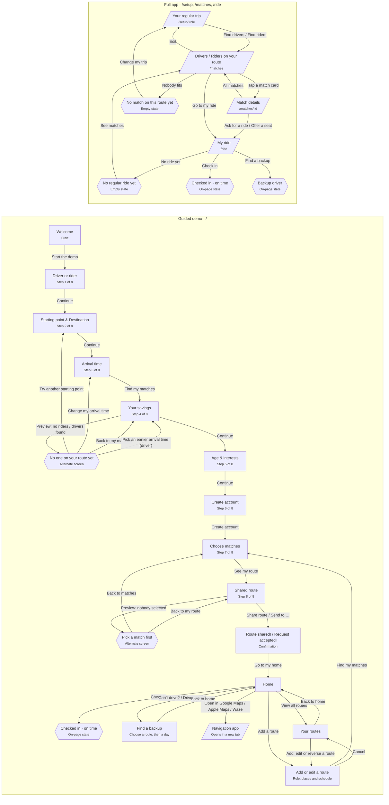

# Routemate demo flow

Every screen in the guided demo and the full app, and what moves you between them.

## Screens

### Guided demo · /

The walkthrough judges see at /. The first route has eight numbered steps. Adding or editing a route reuses five steps and keeps the existing account and profile. Answers are kept in this browser, so a reload resumes the same step.

| Screen | Tag | What it shows |
|---|---|---|
| Welcome | Start | “Wanna be my routemate?” and what Routemate does. |
| Driver or rider | Step 1 of 8 | “How do you get there?” Picking a card moves on by itself. |
| Starting point & Destination | Step 2 of 8 | Driver: “Where do you start?” "What is your destination?" Rider: “Where can you be picked up?" "What is your destination?” Each is a search box that autocompletes from a local list of stations, malls and campuses, prefilled for the demo. A live map below shows the route; both pins can be dragged and snap to a nearby known spot. A meeting point, never a home address. |
| Arrival time | Step 3 of 8 | “When do you need to be there?” Drag the hour, minute (5-minute steps) and AM/PM wheels; starts at 8:00 AM. Then which days. |
| Your savings | Step 4 of 8 | “Good news”: money back for drivers and original trip time then added trip time, time, reliability, and cost for riders. Shown before any account. |
| No one on your route yet | Alternate screen | The demo always finds matches, so testers open this with “Preview: no riders found” (or drivers) on Your savings, and return with “Back to my matches”. Drivers also see “Could you arrive a little earlier?” with up to three earlier arrival times (10, 20 and 30 minutes earlier) that have riders, each with the rider count, added drive time and monthly saving; tapping one sets that time and returns to Your savings. |
| Age & interests | Step 5 of 8 | Drag the age wheel (18 and up) and tap any topics you like. Shared interests and age proximity help rank eligible matches. |
| Create account | Step 6 of 8 | Name and email, Continue with Apple or Google (with their logos), or “Fill in demo details”. Matches see a first name, age, shared interests and an approximate starting area. |
| Choose matches | Step 7 of 8 | Driver: “pick your passengers” within seats and the 10-minute detour limit. The limit can be typed or stepped (5–20 min); if the route goes over it, “Raise my limit to … min” accepts the new time in one tap. Rider: “pick your driver”. |
| Shared route | Step 8 of 8 | Map, pickup times and the even cost split, to check before sharing. |
| Pick a match first | Alternate screen | Opened with “Preview: nobody selected” on Shared route; “Back to my route” returns. |
| Route shared! / Request accepted! | Confirmation | Who is riding and the weekly pattern. The other side's yes is simulated. “Go to my home” continues. |
| Home | Dashboard | The next departure or pickup across all saved routes, who is riding, map and directions, and an estimated cost or savings. “Add a route” starts setup for another trip. |
| Your routes | Route management | View saved routes and schedules. Edit one or start a return trip with the endpoints reversed and a suggested 6:00 PM arrival. |
| Find a backup | Route and day | Choose the route first, then a scheduled date. See the replacement driver if one is available, or use Undo to clear the request. |
| Navigation app | External link | On Home, “Open the route in” (driver) or “Get to your pickup with” (rider): Google Maps, Apple Maps or Waze in a new tab. Google Maps loads the start, every pickup and the destination; Apple Maps and Waze web links take one destination, so they open the first pickup (driver) or the meeting point (rider, walking directions). |
| Checked in | On-page state | Riders select “I've arrived” on Home. Drivers see the check-in status after “Simulate passengers checking in” is selected in the presenter controls. |
| Demo always matches | Note | Sample commuters are fitted to whatever trip the tester enters (destination, time, days, and moved onto the route if needed), so every start, destination, time and detour limit finds people. |
| Back, resume and presenter notes | Note | Every numbered step has a Back arrow to the screen you came from. Changing role, endpoints, time, days, age or interests clears the draft match selection. From 900px wide the demo sits in a phone frame with presenter notes beside it. Presenter controls include Restart demo, the theme switch, and simulated passenger check-in when a driver trip is next. On narrow screens the controls sit below the app. |

### Full app · /setup, /matches, /ride

The fuller prototype with its own saved trip. The header shows Matches and My ride once a trip is set up; the logo returns to the guided demo.

| Screen | Tag | What it shows |
|---|---|---|
| Your regular trip | /setup/:role | Role, start, destination, arrive-by, days and detour limit. Switching role swaps the address. |
| Drivers / Riders on your route | /matches | Trip summary, match cards, and near misses with the reason each one fails. |
| Match details | /matches/:id | Person, route, times and suggested contribution. Exact meeting point only after you both accept. |
| My ride | /ride | Accepted note, week strip, next trip with check-in, and away days. |
| Checked in · on time | On-page state | “I've arrived” (rider) or “Simulate … checking in” (driver) swaps the button for the arrival time. |
| Backup driver | On-page state | Pick an away day, then “Find a backup”: “Backup on Thu: …” or “No backup found”. Undo clears it. |
| No match on this route yet | Empty state | Shown on /matches when nobody fits the trip. |
| No regular ride yet | Empty state | Shown on /ride before anyone has accepted. |
| Redirects | Note | With no trip set up, /matches, /matches/:id and /ride send you to /. Unknown addresses go to /. Reset in the footer clears the trip and opens /setup/rider. |
