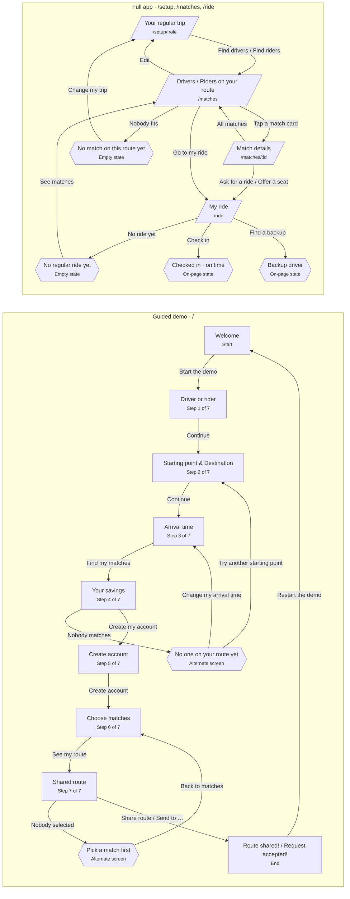

# Routemate demo flow

Every screen in the guided demo and the full app, and what moves you between them. Exported from the editable flowchart (version 2). When the flowchart changes, re-export this file.

## Screens

### Guided demo · /

The walkthrough judges see at /. The progress bar counts steps 1 to 7; Welcome and Done have none. Answers are kept in this browser, so a reload resumes the same step.

| Screen | Tag | What it shows |
|---|---|---|
| Welcome | Start | “Wanna be my routemate?” and what Routemate does. |
| Driver or rider | Step 1 of 7 | “How do you get there?” Picking a card moves on by itself. |
| Starting point & Destination | Step 2 of 7 | Driver: “Where do you start?” "What is your destination?" Rider: “Where can you be picked up?" "What is your destination?” Each is a search box that autocompletes from a local list of stations, malls and campuses, prefilled for the demo. A live map below shows the route; both pins can be dragged and snap to a nearby known spot. A meeting point, never a home address. |
| Arrival time | Step 3 of 7 | “When do you need to be there?” Arrive-by time and which days. |
| Your savings | Step 4 of 7 | “Good news”: money back for drivers and original trip time then added trip time, time, reliability, and cost for riders. Shown before any account. |
| No one on your route yet | Alternate screen | Replaces Your savings when nobody is going your way at that time. |
| Create account | Step 5 of 7 | Name and email, login with apple, login with google, or “Fill in demo details”. Matches only see a first name and an approximate area. |
| Choose matches | Step 6 of 7 | Driver: “pick your passengers” within seats and the 10-minute detour limit. The limit can be typed or stepped (5–20 min); if the route goes over it, “Raise my limit to … min” accepts the new time in one tap. Rider: “pick your driver”. |
| Shared route | Step 7 of 7 | Map, pickup times and the even cost split, to check before sharing. |
| Pick a match first | Alternate screen | Shown if Shared route opens with nobody selected. |
| Route shared! / Request accepted! | End | Who is riding and the weekly pattern. The other side's yes is simulated. |
| Back, resume and presenter notes | Note | Every numbered step has a Back arrow to the screen you came from. Changing role, destination, start, time or days clears the matches you picked. From 900px wide the demo sits in a phone frame with presenter notes beside it. |

### Full app · /setup, /matches, /ride

The fuller prototype with its own saved trip. The header shows Matches and My ride once a trip is set up; the logo returns to the guided demo.

| Screen | Tag | What it shows |
|---|---|---|
| Your regular trip | /setup/:role | Role, start, destination, arrive-by, days and detour limit. Switching role swaps the address. |
| Drivers / Riders on your route | /matches | Trip summary, match cards, and near misses with the reason each one fails. |
| Match details | /matches/:id | Person, route, times and suggested contribution. Exact meeting point only after you both accept. |
| My ride | /ride | Accepted note, week strip, next trip with check-in, and away days. |
| Checked in · on time | On-page state | “I've arrived” (rider) or “Simulate … checking in” (driver) swaps the button for the arrival time. |
| Backup driver | On-page state | Pick an away day, then “Find a backup”: “Backup on Thu: …” or “No backup found”. Undo clears it. |
| No match on this route yet | Empty state | Shown on /matches when nobody fits the trip. |
| No regular ride yet | Empty state | Shown on /ride before anyone has accepted. |
| Redirects | Note | With no trip set up, /matches, /matches/:id and /ride send you to /. Unknown addresses go to /. Reset in the footer clears the trip and opens /setup/rider. |
